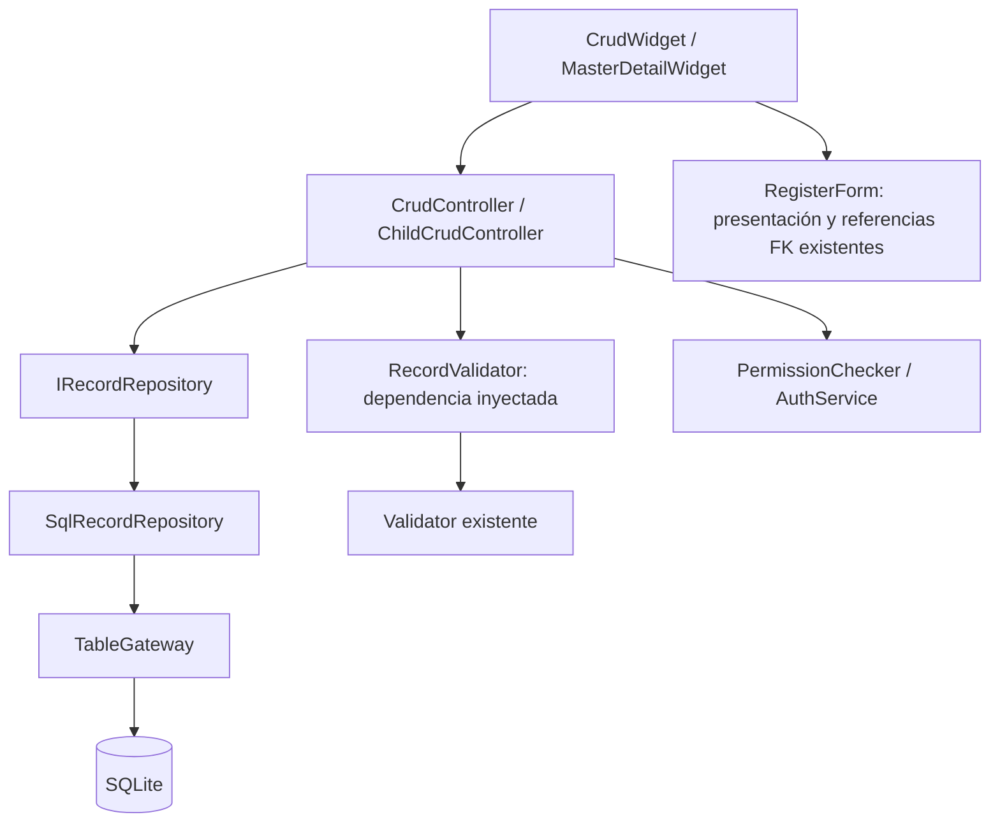
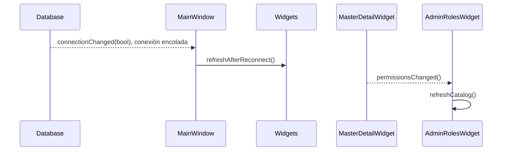

# MVC, Repository y Observer — entrega P1

## Problema resuelto

Antes de esta entrega, `CrudWidget` y `MasterDetailWidget` coordinaban la validación,
los campos automáticos, las contraseñas y las escrituras en la base de datos. La
protección de algunas operaciones dependía del estado de los botones de la pantalla.

Ahora los widgets delegan las operaciones en `CrudController` y
`ChildCrudController`. Los controladores mantienen el estado de la operación,
comprueban permisos y coordinan la validación y persistencia mediante dependencias
inyectadas. Pueden utilizarse y comprobarse sin construir una ventana ni ejecutar SQL.

La entrega conserva los constructores públicos de ambos widgets, sus nombres de
objetos, los controles existentes y la señal `permissionsChanged`. No modifica
`MainWindow`, `AdminRolesWidget`, `RegisterForm`, `Validator`, `TableGateway`, el
esquema ni la matriz de 43 permisos.

## Responsabilidades y colaboración



| Parte de MVC | Implementación | Responsabilidad |
|---|---|---|
| Modelo y acceso al modelo | `TableSpec`, registros `QVariantMap`, repositorio y gateway | Describir y almacenar registros; representar resultados y errores |
| Vista | `CrudWidget`, `MasterDetailWidget`, `RegisterForm` y modelos visuales Qt | Capturar entradas, mostrar filas, selección, botones y mensajes |
| Controlador | `CrudController` y `ChildCrudController` | Coordinar permisos, estado, preparación, validación y operaciones sobre registros |

`QStandardItemModel` continúa siendo el modelo de presentación de las tablas Qt.
La lógica de aplicación no depende de él. El control de salud/reconexión de la base
continúa en `Database` y las vistas existentes; el controlador recibe los fallos de
persistencia como resultados y conserva los cambios pendientes para reintentar.

## Contrato de repositorio y patrón Repository

Archivos:

- `src/core/crud/repositories/i_record_repository.h`
- `src/core/crud/repositories/sql_record_repository.h/.cpp`

`IRecordRepository` representa una colección de registros. Su implementación SQL
se vincula a un `TableSpec` y, para hijos, también a un `ChildTableSpec` al
construirse. El consumidor no envía nombres de tablas o consultas en cada petición.

| Operación del contrato | Significado |
|---|---|
| `load(parentKey)` | Obtener la colección; `parentKey` delimita los hijos |
| `add(values, parentKey)` | Agregar un registro a la colección |
| `change(pk, values, parentKey)` | Cambiar un registro por su identidad |
| `setState(pk, state, parentKey)` | Cambiar su estado lógico |
| `remove(pk, parentKey)` | Quitar un hijo; no permite borrar físicamente un registro independiente |
| `grantPermission(session, roleKey, permissionKey)` | Otorgar un permiso por la vía autorizada |
| `revokePermission(session, roleKey, linkKey)` | Revocar una asignación por su ID y rol |

Los dos últimos métodos solo se admiten en la colección hija de permisos de roles.
Las operaciones genéricas de esa colección son rechazadas por el adaptador,
incluidas alta, modificación, estado y borrado. La implementación autorizada
continúa comprobando la sesión en el gateway existente.

Los resultados no contienen consultas, conexiones ni errores del driver:

```cpp
struct RecordListResult {
    bool success;
    QString error;
    QList<QVariantMap> records;
};

struct RecordWriteResult {
    bool success;
    QString error;
    QVariant pk;
};
```

Una lectura correcta sin registros tiene `success == true` y `records` vacío.
Una lectura fallida tiene `success == false` y un mensaje seguro. Así el controlador
no confunde una tabla vacía con una caída de la base.

**Justificación del patrón:** el controlador trabaja con una colección y un
contrato sustituible; `SqlRecordRepository` adapta esa colección a la persistencia
existente. En las comprobaciones se reemplazó por un repositorio en memoria sin SQL.
`TableGateway` conserva su patrón de acceso por tabla y sus transacciones; no fue
renombrado ni sustituido por un ORM.

**Límite:** se trata de un repositorio genérico de registros apoyado en metadatos y
`QVariantMap`, no de un modelo de entidades de dominio tipadas ni una unidad de
trabajo que guarde un agregado completo en una sola transacción. La autorización
de aplicación corresponde al controlador; el repositorio genérico no reemplaza
esa política.

## Controladores y flujo de operaciones

Archivos:

- `src/core/crud/controllers/crud_controller.h/.cpp`
- `src/core/crud/controllers/child_crud_controller.h/.cpp`

`CrudController` recibe el descriptor, una copia de la sesión, un
`IRecordRepository&` y un `RecordValidator`. Esta última dependencia es una función
con el contrato existente del validador:

```cpp
using RecordValidator = std::function<QList<ValidationError>(
    const TableSpec&, const QVariantMap&, bool, const QVariantMap&)>;
```

En producción, la función llama a `Validator::validate`. La ausencia de esta
dependencia rechaza el guardado; no desactiva silenciosamente la validación. En
pruebas, la función puede producir errores concretos y registrar los valores y el
registro original recibidos, sin necesidad de widgets o SQLite.

### API de control para P3

| Método | Resultado o efecto |
|---|---|
| `records()` | Lee mediante el repositorio y aplica permisos de lectura |
| `selectRecord(record)` | Cambia la selección; abandona un alta pendiente y mantiene el modo de modificación al seleccionar otra fila |
| `startAdd()` | Comprueba permiso de alta y pasa de Idle a Adding |
| `startModify()` | Exige selección y permiso; pasa de Idle a Modifying |
| `save(values)` | Prepara, valida y persiste según la operación pendiente |
| `changeState(state)` | Exige selección, permiso, estado válido y ausencia de otra operación pendiente |
| `cancel()` | Limpia selección y operación, sin escribir |
| `can(action)` / `canEdit()` | Expone la política que la vista usa para sus botones |
| `operation()` / `currentRecord()` | Consulta el estado de aplicación sin depender de una tabla Qt |

`ControllerResult` contiene `success`, `error`, `validationErrors` y `pk`. Los
errores de validación permanecen asociados a columnas para que la vista los muestre
juntos. La vista decide si corresponde un mensaje informativo, una advertencia o
un error; el controlador no abre cuadros de diálogo.

El guardado sigue este orden:

1. Verificar operación pendiente, selección cuando corresponde y autorización.
2. Seleccionar campos editables del descriptor. Excluir columnas desconocidas,
   identidad autogenerada, estado y campos administrados por el sistema.
3. Incorporar `created_by_id` desde la sesión al insertar y `updated_at` al modificar.
4. Ejecutar el validador; en edición, entregar también el registro original.
5. Si hay errores, devolverlos sin llamar a la escritura del repositorio.
6. Aplicar `AuthService::hashPassword` a contraseñas válidas antes de persistir.
   Una contraseña vacía en edición se omite y conserva la almacenada.
7. Persistir y restablecer el estado únicamente si la operación tiene éxito.

Ante un error de persistencia o validación, se conserva la operación para corregir
o reintentar. La cancelación no solicita una transacción ni una escritura.

La sesión se copia al construir el controlador, como en las pantallas previas.
Los cambios de permisos de otra sesión se reflejan al volver a iniciar sesión;
esta entrega no introduce actualización automática de permisos en sesiones abiertas.

## Relaciones hijas y seguridad de roles

`ChildCrudController` especializa el flujo común mediante métodos virtuales:
autorización, lectura, ámbito del padre, preparación y persistencia.

- `setParentKey(key)` descarta una operación pendiente y la selección anterior.
- Sin padre no se permiten escrituras y la colección visual queda vacía.
- `selectRecord(record)` rechaza filas cuyo campo padre no coincide con el padre
  actual, incluso al usar el controlador fuera del widget.
- El campo padre se toma siempre del contexto del controlador, no del formulario.
- La edición entrega el registro original al validador para excluir el propio ID
  y recuperar campos no modificados.
- Los constituyentes mantienen borrado lógico y estados `A`, `I`, `*`; los enlaces
  sin ciclo de vida se quitan físicamente mediante el repositorio.
- Consultar asignaciones de un usuario requiere lectura de usuarios o autorización
  de asignación; modificarlas requiere `assign_role_user`. Un Supervisor puede
  seguir consultándolas sin adquirir permiso de escritura.
- La administración de permisos de roles exige `canManageRoles` y una lectura
  correcta de la colección antes de habilitar las escrituras.
- Los permisos de roles se otorgan o revocan; no se editan como registros comunes.
  Se conserva la confirmación visual antes de la revocación.

## Observer ya existente y conservado



Las señales notifican cambios a consumidores registrados mediante `connect` sin
que el emisor tenga que conocer cómo presentan los datos sus observadores.

- `Database` publica el estado de conexión; `MainWindow` observa y coordina la
  recuperación de las pantallas.
- `MasterDetailWidget` emite `permissionsChanged` después de una concesión o
  revocación exitosa; `AdminRolesWidget` observa y refresca su catálogo.

No se añadieron señales artificiales para acreditar el patrón. Los controladores
son clases C++ sin dependencia de `QObject`; Observer continúa en la colaboración
visual existente. La comprobación automática verificó ambas emisiones de cambios
de permisos y la conservación de una edición hija tras reconectar.

## Polimorfismo y vida útil de dependencias

- Polimorfismo propio: `IRecordRepository` tiene destructor virtual y operaciones
  abstractas; el controlador invoca la implementación SQL o un doble de prueba a
  través de esa interfaz.
- `ChildCrudController` sobrescribe los puntos de extensión del controlador base
  y reutiliza el flujo de guardado y gestión de operación.
- El polimorfismo del framework, por ejemplo `GuardedApplication::notify()`, sigue
  siendo parte del proyecto y no se atribuye como una clase nueva de esta entrega.
- Los widgets construyen, en ese orden, gateway, repositorio, validador y
  controlador. El repositorio conserva una referencia al gateway; la función de
  validación utiliza el validador del widget. Todos viven más que el controlador.
- Quien construya un controlador fuera del widget debe garantizar esa misma vida
  útil. No debe capturar un validador temporal ni pasar un repositorio destruido.

## Integración con P2, P3 y P6

**P2:** no se cambió la API de `Validator`. Las estrategias e interfaces de consulta
de P2 pueden incorporarse manteniendo la construcción y la función de validación
actuales. El callback inyectado en P1 no se presenta como la implementación de
Strategy prevista para P2.

**P3:** los contratos anteriores permiten pruebas de controlador con un repositorio
falso. Deben comprobar especialmente ausencia de escrituras ante rechazos,
errores por campo, selección/operación, permiso de alta frente al de cambio,
ámbito padre-hijo y rutas exclusivas de permisos de roles. Las pruebas permanentes
de Qt Test/CTest siguen siendo responsabilidad de P3.

**P6:** al comenzar P1 aún no existían `grat_core` ni los puntos de extensión. Se
agregó únicamente esta inclusión al CMake principal para mantener compilable la rama:

```cmake
include(cmake/features/arquitectura.cmake)
```

El archivo de extensión registra las fuentes de P1 en `grat_core` si ese target
existe y, mientras tanto, en `grat_software`. P6 debe conservar una única inclusión
después de crear los targets. Al separar el núcleo no debe añadir otra vez esas
fuentes al ejecutable. P1 no implementó la infraestructura de pruebas ni CI.

`RegisterForm` y las etiquetas de referencias FK siguen utilizando el gateway para
cargar desplegables. No se afirma que toda la presentación esté desligada de la
capa de datos: esta entrega extrae el control de operaciones y las colecciones de
registros de los dos widgets CRUD, dentro del alcance acordado.

## Verificación realizada en P1

La implementación de los cuatro primeros incrementos quedó en los commits
`240d6b0`, `e1862ff`, `39eeefb` y `06e0cbb`; este documento constituye el cierre de
documentación. No se cambiaron fuentes de otras actividades salvo la inclusión
mínima de CMake descrita arriba.

Entorno de comprobación: GCC 15.2.0, Qt 6.10.2 y CMake con Unix Makefiles. Qt6Svg
no estaba instalado y `sudo` requería autenticación interactiva; se descargaron
los paquetes Qt6Svg compatibles y se extrajeron en `/tmp/grat-p1-qtdeps/prefix`,
sin instalarlos globalmente ni versionarlos.

Comandos utilizados para configurar y compilar la aplicación:

```bash
cmake -S GRAT_Software -B /tmp/grat-p1-app-build -G 'Unix Makefiles' \
  -DCMAKE_CXX_FLAGS='-Wall -Wextra' \
  -DQt6Svg_DIR=/tmp/grat-p1-qtdeps/prefix/usr/lib/x86_64-linux-gnu/cmake/Qt6Svg
cmake --build /tmp/grat-p1-app-build -j 2
```

La ruta de `Qt6Svg_DIR` es específica del entorno temporal de esta verificación;
no se necesita al tener las dependencias instaladas y detectables normalmente.
La aplicación completa compiló sin advertencias del compilador en la salida observada.

Se ejecutaron programas C++ locales en `/tmp/grat-p1-check`, sin incorporarlos a
la suite de P3:

| Programa | Aserciones aprobadas | Alcance |
|---|---:|---|
| `repository_check` | 22 | Esquema real en SQLite aislado; colección vacía/error; CRUD y estados; hijos; rechazo de modificaciones genéricas de permisos; concesión y revocación autorizadas |
| `controller_check` | 48 | Repositorio falso sin SQL; permisos, selección, cancelación, validación, contraseñas, campos automáticos, hijos y administración de roles |
| `widget_check` | 68 | Widgets con base temporal, usuarios y autenticación reales; CRUD, validación sin escritura, tres roles, maestro-detalle, reconexión y señales de permisos |

También se compiló el contrato de repositorio comprobando que es abstracto y que
su destructor es virtual. Los tres programas suman **138 aserciones**; algunas
comprueban la disponibilidad de controles como parte del escenario, no representan
138 pruebas unitarias independientes.

Comandos de ejecución locales:

```bash
/tmp/grat-p1-check/build/contract
/tmp/grat-p1-check/build/repository_check
/tmp/grat-p1-check/build/controller_check
QT_QPA_PLATFORM=offscreen /tmp/grat-p1-check/build/widget_check
```

Los programas temporales no se distribuyen con la aplicación; las rutas anteriores
documentan la ejecución de esta sesión y no son una suite reproducible en otro
checkout. P3 debe versionar los casos equivalentes en su infraestructura de pruebas.
El modo `offscreen` verifica interacción programática, no apariencia ni demo manual.

Quedan a cargo de sus respectivos integrantes la suite persistente, Strategy,
reportes, CI y la aceptación manual de la versión final integrada.
