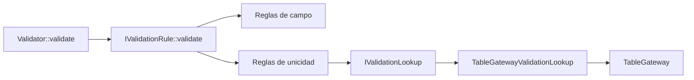

# Strategy, polimorfismo y propiedad en la validación CRUD

## Strategy: reglas independientes y un validador que las compone

[`IValidationRule`](../../src/core/crud/validation/i_validation_rule.h) define un destructor virtual y una operación común, `validate(context, errors)`. El `ValidationContext` da acceso de solo lectura a los metadatos (`TableSpec`), los valores enviados, el modo de operación, el registro original y el lookup. En la fase de campos también identifica la columna actual. Cada regla añade sus errores a la misma lista; no modifica el registro ni escribe datos.

| Fase | Reglas concretas | Orden de ejecución |
|---|---|---|
| Campo | [`RequiredRule`, `MaxLengthRule`, `NonNegativeDecimalRule`, `EmailRule`](../../src/core/crud/validation/field_validation_rules.cpp) | Se ejecutan en ese orden para cada columna elegible, siguiendo el orden de los metadatos. Se omiten los campos administrados por el sistema, los de estado y la clave autogenerada. |
| Registro | [`NaturalKeyUniquenessRule`, `ConstituentUniquenessRule`](../../src/core/crud/validation/record_validation_rules.cpp) | Se ejecutan una vez por registro y después de todos los campos, en ese orden. |

[`Validator`](../../src/core/crud/validator.cpp) compone ambas fases con `ValidationRuleSet`. `Validator::defaultRules()` devuelve la configuración habitual. Para incorporar o sustituir una estrategia, el consumidor modifica la lista de la fase correspondiente y entrega el conjunto al constructor. No hace falta añadir una rama para el nuevo tipo de regla en `Validator::validate()`.



## Abstracciones propias y despacho polimórfico

- **Validación del proyecto.** `Validator::validate()` llama por la interfaz `IValidationRule` y C++ ejecuta la implementación concreta de cada objeto. En la aplicación, [`CrudWidget`](../../src/ui/crud_widget.cpp) y [`MasterDetailWidget`](../../src/ui/master_detail_widget.cpp) conectan su validador al controlador mediante un callback. El despacho de las reglas ocurre dentro de ese callback, cuando [`CrudController::save()`](../../src/core/crud/controllers/crud_controller.cpp) valida los valores preparados antes de persistirlos. [`ChildCrudController`](../../src/core/crud/controllers/child_crud_controller.h) reutiliza ese flujo.
- **Consultas del proyecto.** [`IValidationLookup`](../../src/core/crud/validation/i_validation_lookup.h) expone solo dos consultas: por clave primaria y por pareja residuo–constituyente, con opción de excluir un ID. Al ejecutar una regla de unicidad, la llamada virtual va a [`TableGatewayValidationLookup`](../../src/core/crud/validation/table_gateway_validation_lookup.cpp) en las pantallas o a un lookup falso en las comprobaciones. El adaptador delega en [`TableGateway`](../../src/core/crud/table_gateway.cpp), que mantiene las consultas SQL. `Found`, `NotFound` y `QueryError` distinguen duplicado, ausencia y fallo: un fallo añade un error de validación y no permite continuar como si no hubiera duplicado.
- **Framework Qt.** [`GuardedApplication::notify()`](../../src/main.cpp) sobrescribe `QApplication::notify()`. Qt llama a esa sobreescritura al entregar un evento; esta delega la entrega a la implementación base y captura excepciones inesperadas. Es polimorfismo del framework en el despacho de eventos, no una estrategia de validación ni una abstracción introducida por este cambio.

La regla de clave natural consulta solo en las altas con clave no autogenerada y no vacía. En las ediciones parciales de un constituyente, la regla recupera del registro original las claves no enviadas y usa el ID original para excluir la propia fila. La consulta no filtra por estado: una pareja repetida se rechaza aunque la fila esté inactiva o eliminada. El mismo constituyente sí puede aparecer en otro residuo.

## Propiedad y vida útil

- **Reglas de validación.** [`ValidationRuleSet`](../../src/core/crud/validator.h) contiene dos vectores de `std::unique_ptr<IValidationRule>`. Así puede almacenar implementaciones distintas sin copiarlas ni compartir su propiedad. El conjunto se transfiere al `Validator`, que destruye las reglas al finalizar su vida útil mediante el destructor virtual de la interfaz.
- **Lookup.** Al construir `Validator` con un `TableGateway`, el validador posee el adaptador y este solo toma prestado el gateway, que debe vivir más que el validador. Si se inyecta un `IValidationLookup`, el llamador conserva su propiedad y debe mantenerlo vivo. Los constructores rechazan temporales y `Validator` no se copia ni se mueve.
- **Widgets.** Las reglas no son `QObject`. Los widgets conservan el modelo padre–hijo de Qt: el padre destruye sus hijos, sin necesidad de añadir un segundo propietario con `std::unique_ptr`. Por ejemplo, [`MainWindow::createPage()`](../../src/ui/main_window.cpp) asigna `stackedWidget` como padre de las páginas CRUD y de administración; `MasterDetailWidget` crea su `RegisterForm` con `this` como padre.

## Límites y verificación

El cambio se limita a la validación CRUD y a registrar sus fuentes en [`validacion.cmake`](../../cmake/features/validacion.cmake). No modifica las pantallas, el esquema SQL ni el flujo de persistencia. No se hizo una prueba manual de la interfaz ni una prueba de integración de las estrategias contra SQLite. `db/grat.db` no se usó ni se modificó.

**Commit de código probado:** `e1a5f20` — *Componer estrategias para unicidad y relaciones hijas*. Desde la raíz del repositorio se ejecutó:

```bash
build=/tmp/opencode/grat-validacion.PaohbY
cmake -S GRAT_Software -B "$build" -G Ninja -DBUILD_TESTING=ON
cmake --build "$build" -j 4
ctest --test-dir "$build" --output-on-failure
```

La aplicación compiló y enlazó. CTest pasó **1/1** (`test_reportes`); esa suite no cubre las estrategias. Por separado se compilaron y ejecutaron dos programas de comprobación locales, con lookups falsos y sin abrir SQLite:

```bash
core="$build/CMakeFiles/grat_software.dir/src/core"
for kind in field record; do
    c++ -fPIC -std=c++20 -I GRAT_Software/src $(pkg-config --cflags Qt6Core Qt6Sql) \
        "/tmp/opencode/grat-validation-$kind-check.cpp" \
        "$core"/crud/{validator,table_gateway}.cpp.o \
        "$core"/crud/validation/{field_validation_rules,record_validation_rules,table_gateway_validation_lookup}.cpp.o \
        "$core"/auth/permission_checker.cpp.o "$core"/errors/error_handler.cpp.o \
        $(pkg-config --libs Qt6Core Qt6Sql) -o "/tmp/opencode/grat-validation-$kind-current" &&
        "/tmp/opencode/grat-validation-$kind-current" || exit 1
done
```

Ambos terminaron con código `0`. `field` comprobó longitud en el límite y por encima, cero y negativos, correo válido e inválido, orden de errores simultáneos, edición parcial y exclusión de campos de sistema. `record` comprobó clave natural libre y repetida, duplicados de pareja en estados `A`, `I` y `*`, el mismo constituyente en otro residuo, exclusión del propio ID, errores de ambas consultas y la incorporación y sustitución de reglas. Los programas de `/tmp/opencode/` no están versionados: los comandos registran la verificación local, no una nueva suite distribuida.
